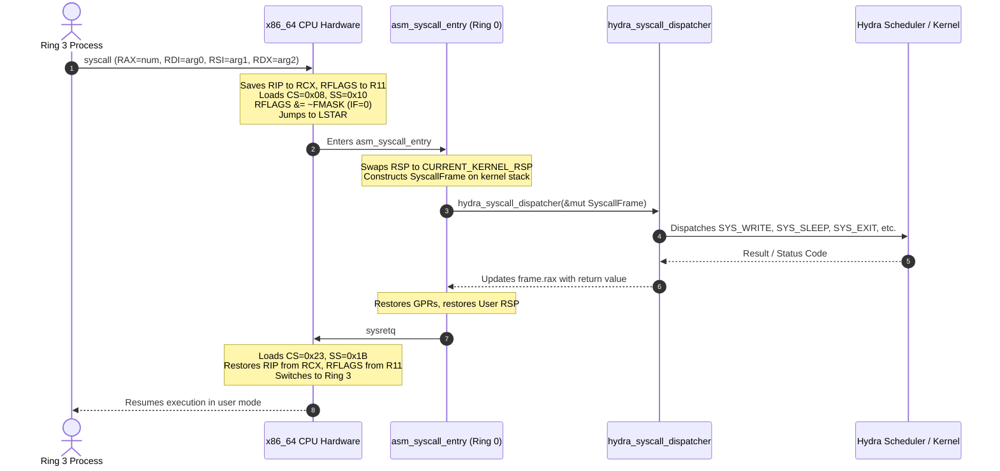

# Ring 3 User Mode & Hardware System Calls (`syscall` / `sysretq`)

## Overview

**Phase 3** introduces hardware-enforced CPU privilege rings and the fast system call interface to Hydra OS. In long mode x86_64, the kernel transitions from pure kernel-mode threads (Ring 0) to unprivileged user processes executing at Current Privilege Level 3 (**Ring 3**). 

The boundary between userland and the microkernel is guarded by:
1. **Model-Specific Registers (MSRs)**: `IA32_EFER.SCE`, `IA32_STAR`, `IA32_LSTAR`, and `IA32_FMASK` configuring the hardware `syscall` and `sysretq` instructions.
2. **Task State Segment (TSS) Privilege Stack (`RSP0`)**: Ensuring hardware interrupts and exceptions originating from Ring 3 safely pivot to a trusted per-task kernel stack.
3. **4-Level Paging Protection (`USER_ACCESSIBLE`)**: Granular page table permissions separating supervisor-only memory from user-accessible memory.
4. **Hardware Fault Isolation**: Intercepting user-mode General Protection Faults (#GP) and Page Faults (#PF) to terminate offending processes without compromising kernel stability.

The core implementation is split across:
- **Syscall MSRs & Assembly Dispatcher**: [`src/arch/syscall.rs`](file:///d:/os/src/arch/syscall.rs)
- **Userland Syscall Library**: [`src/syscall/user.rs`](file:///d:/os/src/syscall/user.rs)
- **GDT & TSS RSP0 Configuration**: [`src/arch/gdt.rs`](file:///d:/os/src/arch/gdt.rs)
- **Page Table User Accessibility**: [`src/memory/paging.rs`](file:///d:/os/src/memory/paging.rs)
- **Process Spawning & Preemption**: [`src/task/scheduler.rs`](file:///d:/os/src/task/scheduler.rs)
- **Shell Diagnostics**: [`src/shell/commands/task_cmds.rs`](file:///d:/os/src/shell/commands/task_cmds.rs)

---

## Hardware System Call Architecture



---

## Model-Specific Registers (MSR) Configuration

During hardware takeover in [`src/arch/boot_services.rs`](file:///d:/os/src/arch/boot_services.rs), the kernel programs the four architectural system call MSRs via [`crate::arch::syscall::init()`](file:///d:/os/src/arch/syscall.rs):

| MSR Address | Register Name | Configured Value | Description |
|:---|:---|:---|:---|
| `0xC0000080` | `IA32_EFER` | Bit 0 (`SCE = 1`) | **System Call Extensions**: Enables the `syscall` and `sysretq` instructions in 64-bit mode. |
| `0xC0000081` | `IA32_STAR` | `0x0013_0008_0000_0000` | **Segment Selectors**: Bits [47:32] set Kernel CS to `0x08` (Kernel SS auto `0x10`). Bits [63:48] set User base to `0x13`, causing `sysretq` to load User SS = `0x1B` (0x13+8) and User CS = `0x23` (0x13+16). |
| `0xC0000082` | `IA32_LSTAR` | Virtual address of `asm_syscall_entry` | **Target Instruction Pointer**: Canonical entry point where the CPU jumps upon executing `syscall`. |
| `0xC0000084` | `IA32_FMASK` | `0x0004_4700` | **Flags Mask**: Clears Interrupt Flag (IF: `0x200`), Trap Flag (TF: `0x100`), Direction Flag (DF: `0x400`), Nested Task (NT: `0x4000`), and Alignment Check (AC: `0x40000`) on syscall entry. |

---

## Assembly Syscall Trampoline (`asm_syscall_entry`)

Because the x86_64 `syscall` instruction does **not** switch the stack pointer (`RSP`), the CPU enters kernel mode with `RSP` still pointing into untrusted user space. The assembly trampoline immediately pivots to the task's kernel stack before saving registers:

```asm
.global asm_syscall_entry
asm_syscall_entry:
    // 1. Preserve user RSP in scratch and switch to current task kernel stack
    mov [rip + USER_RSP_SCRATCH], rsp
    mov rsp, [rip + CURRENT_KERNEL_RSP]

    // 2. Build SyscallFrame on kernel stack
    push qword ptr [rip + USER_RSP_SCRATCH] // User RSP
    push r11                                // User RFLAGS
    push rcx                                // User RIP
    push rbx
    push rbp
    push r12
    push r13
    push r14
    push r15
    push rax                                // Syscall number
    push rdi                                // Arg 0
    push rsi                                // Arg 1
    push rdx                                // Arg 2
    push r10                                // Arg 3
    push r8                                 // Arg 4
    push r9                                 // Arg 5

    // 3. Call Rust dispatcher (passes &mut SyscallFrame in RCX and RDI)
    mov rcx, rsp
    mov rdi, rsp
    sub rsp, 48
    call hydra_syscall_dispatcher
    add rsp, 48

    // 4. Restore registers and user stack
    pop r9
    pop r8
    pop r10
    pop rdx
    pop rsi
    pop rdi
    pop rax                                 // Syscall return value in RAX
    pop r15
    pop r14
    pop r13
    pop r12
    pop rbp
    pop rbx
    pop rcx                                 // Restore User RIP
    pop r11                                 // Restore User RFLAGS
    pop rsp                                 // Restore User RSP directly

    // 5. Return to unprivileged Ring 3
    sysretq
```

---

## Task State Segment (TSS) & Interrupt Stack Switching

When a hardware interrupt (such as IRQ 0 PIT timer or IRQ 1 keyboard) or a CPU exception (#GP, #PF) fires while running in Ring 3:
1. The CPU hardware reads `RSP0` from the active TSS (`privilege_stack_table[0]`).
2. The hardware switches `RSP` to `RSP0`.
3. The hardware pushes `SS` (0x1B), `RSP` (user stack), `RFLAGS`, `CS` (0x23), `RIP`, and error code onto the task's kernel stack.
4. The interrupt routine runs safely in Ring 0.
5. Upon returning, `iretq` automatically pops the user context and drops back to Ring 3.

Whenever the scheduler performs a context switch in [`src/task/scheduler.rs`](file:///d:/os/src/task/scheduler.rs), it synchronizes both hardware stack pointers:

```rust
// Update hardware TSS RSP0 and SYSCALL kernel RSP for the incoming task
let kernel_top = next_task.kernel_stack_top();
crate::arch::gdt::set_privilege_stack(x86_64::VirtAddr::new(kernel_top));
crate::arch::syscall::set_kernel_rsp(kernel_top);
```

---

## Registered System Calls

Hydra OS provides a microkernel system call table:

| Syscall # | Name | Signature | Description |
|:---|:---|:---|:---|
| `1` | `SYS_YIELD` | `sys_yield()` | Cooperatively relinquishes the current timeslice to the next ready task. |
| `2` | `SYS_SLEEP` | `sys_sleep(ms: u64)` | Suspends the process for a duration in milliseconds. |
| `3` | `SYS_WRITE` | `sys_write(buf: *const u8, len: u64)` | Writes a UTF-8 character buffer directly to the linear framebuffer console. |
| `4` | `SYS_EXIT` | `sys_exit() -> !` | Permanently terminates the calling process and yields CPU ownership. |
| `5` | `SYS_GETPID` | `sys_getpid() -> u64` | Queries the process identifier (PID) of the calling task. |
| `6` | `SYS_UPTIME` | `sys_uptime() -> u64` | Queries elapsed PIT timer ticks (100 Hz = 10 ms per tick). |
| `7` | `SYS_IPC_SEND` | `sys_ipc_send(ep: u32, msg: *const Message)` | Sends an IPC message to a microkernel endpoint. |
| `8` | `SYS_IPC_RECV` | `sys_ipc_recv(ep: u32, msg: *mut Message)` | Receives an IPC message from a microkernel endpoint. |

---

## Memory Protection & Fault Isolation

### CR0.WP Page Table Manipulation (`make_user_accessible`)

Under UEFI firmware, page tables are marked read-only with CR0.WP (Write Protect) enabled. When allocating user stacks on the heap, the kernel clears CR0.WP temporarily to mark intermediate page table entries (PML4, PDPT, PD, PT) with `PageTableFlags::USER_ACCESSIBLE | PageTableFlags::WRITABLE`:

```rust
// Temporarily clear CR0.WP (bit 16)
core::arch::asm!(
    "mov {tmp}, cr0",
    "btr {tmp}, 16",
    "mov cr0, {tmp}",
    tmp = out(reg) _,
    options(nostack, preserves_flags),
);
// Mark hierarchy levels USER_ACCESSIBLE
...
// Re-enable CR0.WP
core::arch::asm!(
    "mov {tmp}, cr0",
    "bts {tmp}, 16",
    "mov cr0, {tmp}",
    tmp = out(reg) _,
    options(nostack, preserves_flags),
);
```

### Process Isolation on Hardware Faults

If a user process performs an illegal operation (e.g. executing `cli`, `hlt`, `in`, `out`, or accessing invalid memory):
- **General Protection Fault (#GP, Vector 13)**: Intercepted in [`src/arch/idt.rs`](file:///d:/os/src/arch/idt.rs). If `(ctx.cs & 3) == 3`, the kernel reports the fault address, kills only the offending task (`sched.terminate_current()`), and immediately switches to another ready task.
- **Page Fault (#PF, Vector 14)**: If `(ctx.error_code & 4) != 0` (user-mode fault), the kernel reports a Segmentation Fault, kills the task, and maintains system integrity.
- **The interactive shell and other tasks remain completely unaffected.**

---

## Interactive Shell Verification

Three shell commands expose and verify Phase 3 functionality:

```text
hydra:/bin> syscalls

============================================================
[+] HYDRA MICROKERNEL: HARDWARE SYSTEM CALL SUBSYSTEM
============================================================
Hardware MSR Registers:
  - IA32_EFER.SCE (0xC0000080) : 0x0000000000000d01 (SCE=1)
  - IA32_STAR     (0xC0000081) : 0x0013000800000000
    * Kernel CS:SS Base : 0x0008 / 0x0010
    * User CS:SS Base   : 0x0013 (CS=0x0023, SS=0x001b)
  - IA32_LSTAR    (0xC0000082) : 0x0000000001dd79364 (asm_syscall_entry)
  - IA32_FMASK    (0xC0000084) : 0x0000000000044700 (Flags masked on entry)

Registered System Calls & Invocation Counts:
  - [1] SYS_YIELD    : 0 calls
  - [2] SYS_SLEEP    : 4 calls
  - [3] SYS_WRITE    : 10 calls
  - [4] SYS_EXIT     : 1 calls
  - [5] SYS_GETPID   : 1 calls
  - [6] SYS_UPTIME   : 1 calls
  - [7] SYS_IPC_SEND : 0 calls
  - [8] SYS_IPC_RECV : 0 calls
  ---------------------------------------------
  * Total Hardware System Calls Handled: 17
============================================================

hydra:/bin> ps
PID   NAME        MODE    STATE     PRIORITY    TICKS        STACK (RSP)
------------------------------------------------------------------------------
0     shell       Kernel  Running   Normal       6298 0x0000000001fe5e80
1     idle        Kernel  Ready     Idle            0 0x00000000017a3190
2     user_demo   User    Dead      Normal          8 0x00000000017a8870
3     rogue_task  User    Dead      Normal          2 0x00000000017b6188
------------------------------------------------------------------------------
Total tasks: 4 | Timeslice: 50 ms | Worker counter: 0
```
