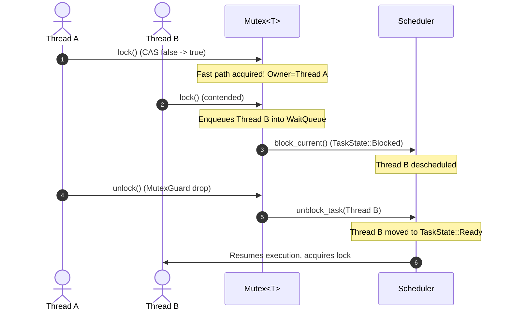

# Microkernel Synchronization Primitives & Wait Queues

## Overview

In **Phase 4**, Hydra OS activates the `TaskState::Blocked` lifecycle state in the scheduler and introduces true sleeping synchronization primitives. Unlike busy-wait spinlocks that burn CPU cycles, sleep-locks transition contended threads to a suspended state and deschedule them immediately. When the lock or resource becomes available, the wait-queue awakens the thread, returning it to `TaskState::Ready`.

The synchronization subsystem is implemented in [`src/sync/`](file:///d:/os/src/sync/) and integrated with the preemptive scheduler in [`src/task/scheduler.rs`](file:///d:/os/src/task/scheduler.rs) and the IPC subsystem in [`src/ipc/endpoint.rs`](file:///d:/os/src/ipc/endpoint.rs).

---

## Core Primitives

### 1. Wait Queue (`WaitQueue`)

The [`WaitQueue`](file:///d:/os/src/sync/wait_queue.rs) maintains a FIFO queue of suspended tasks (`TaskId`) awaiting an event:

```rust
pub struct WaitQueue {
    waiters: VecDeque<TaskId>,
}
```

- **`wait(&mut self)`**: Captures the current `TaskId`, enqueues it, marks the task as `TaskState::Blocked`, and invokes `yield_now()` to relinquish the CPU immediately.
- **`wake_one(&mut self) -> Option<TaskId>`**: Dequeues the oldest waiting task and transitions it to `TaskState::Ready`.
- **`wake_all(&mut self) -> usize`**: Dequeues and unblocks all waiting tasks.

---

### 2. Sleeping Mutex (`Mutex<T>`)

The [`Mutex<T>`](file:///d:/os/src/sync/mutex.rs) provides mutual exclusion with automatic thread suspension:

```rust
pub struct Mutex<T> {
    locked: AtomicBool,
    owner: AtomicU64,
    waiters: SpinLock<WaitQueue>,
    data: UnsafeCell<T>,
}
```

- **Fast Path**: Uncontended acquisition succeeds via atomic CAS (`compare_exchange(false, true)`), requiring zero context switches or allocations.
- **Contention Path**: If already locked, the calling task registers in `waiters`, transitions to `TaskState::Blocked`, and yields the CPU.
- **Release**: When the `MutexGuard` is dropped, ownership is cleared, and `waiters.wake_one()` is called to reschedule the next waiter.



---

### 3. Counting Semaphore (`Semaphore`)

The [`Semaphore`](file:///d:/os/src/sync/semaphore.rs) manages shared permits:
- **`acquire()`**: Atomically decrements `permits`. If no permits remain, the caller is enqueued in the semaphore's `WaitQueue` and suspended.
- **`release()`**: Increments `permits` and awakens one waiting task from the queue.

---

### 4. Condition Variable (`CondVar`)

The [`CondVar`](file:///d:/os/src/sync/condvar.rs) enables threads to suspend execution until a condition predicate is satisfied:
- **`wait(guard: MutexGuard<T>)`**: Atomically releases the held mutex, enqueues the thread in the condition variable's wait queue, and blocks. When awakened, it re-acquires the mutex before returning.
- **`notify_one()`**: Wakes a single waiting thread.
- **`notify_all()`**: Wakes all waiting threads.

---

### 5. Synchronized Bounded Channel (`Channel<T>`)

The [`Channel<T>`](file:///d:/os/src/sync/channel.rs) implements thread-safe message passing:
- **`send(&self, item: T)`**: Blocks if the channel buffer is at capacity until a receiver consumes data.
- **`recv(&self) -> T`**: Blocks if the channel is empty until a sender transmits an item.

---

## Blocking Inter-Process Communication (IPC)

In [`src/ipc/endpoint.rs`](file:///d:/os/src/ipc/endpoint.rs), microkernel endpoints feature integrated send and receive wait queues:

```rust
pub struct Endpoint {
    id: u32,
    buffer: [Option<Message>; QUEUE_CAPACITY],
    head: usize,
    tail: usize,
    count: usize,
    send_waiters: WaitQueue,
    recv_waiters: WaitQueue,
}
```

- **`send_blocking(msg)`**: Transmits a message, suspending the sender if the queue is full. Awakens any blocked receivers.
- **`receive_blocking() -> Message`**: Extracts a message, suspending the receiver if the queue is empty. Awakens any blocked senders.
- **System Endpoints (`SYSTEM_ENDPOINTS[0..15]`)**: Global shared rendezvous ports accessible both by kernel threads and user processes via `SYS_IPC_SEND` and `SYS_IPC_RECV` system calls.

---

## Interactive Shell Verification

The subsystem is fully verified in the shell:

```text
hydra:/bin> sync

============================================================
[+] HYDRA MICROKERNEL: SYNCHRONIZATION & WAIT QUEUES
============================================================
  Sleep-Lock Mutex Status (DEMO_MUTEX):
    - State           : UNLOCKED
    - Owner PID       : 0
    - Blocked Waiters : 0

  Active System IPC Endpoints (0..15):
    EP_ID PENDING_MSGS WAIT_RECEIVERS WAIT_SENDERS
    --------------------------------------------------
    0     0            0              0
    1     0            0              0
    2     0            0              0

  Scheduler Task State Summary:
    - Running: 1 | Ready: 1 | Blocked: 0 | Sleeping: 0
============================================================

hydra:/bin> spawn consumer
[+] Spawned consumer task #4 waiting on Endpoint #1.
    Type 'ps' to observe consumer transitioning into Blocked state.
    Run 'spawn producer' to deliver messages and unblock it.
hydra:/bin>  [Consumer] Calling receive_blocking() on Endpoint #1 (will Block if empty)...
ps
PID   NAME        MODE    STATE     PRIORITY    TICKS        STACK (RSP)
------------------------------------------------------------------------------
0     shell       Kernel  Running   Normal        749 0x0000000001fe5e4e0
1     idle        Kernel  Ready     Idle            0 0x00000000017a3190
2     worker_a    Kernel  Dead      Normal          2 0x00000000017a8938
3     worker_b    Kernel  Dead      Normal          3 0x00000000017ae148
4     consumer    Kernel  Blocked   Normal          1 0x00000000017b3828
------------------------------------------------------------------------------

hydra:/bin> spawn producer
[+] Spawned Producer task #5 feeding Endpoint #1.
hydra:/bin>  [Producer] Depositing message #1 to Endpoint #1...
[Producer] Message #1 sent.
[Consumer] Received message from Endpoint #1: label=0x1001, arg0=1
[Producer] Depositing message #2 to Endpoint #1...
[Producer] Message #2 sent.
[Consumer] Received message from Endpoint #1: label=0x1002, arg0=2
[Producer] Depositing message #3 to Endpoint #1...
[Producer] Message #3 sent.
[Producer] Completed sending batch.
[Consumer] Received message from Endpoint #1: label=0x1003, arg0=3
[Consumer] Completed receiving batch.
```
