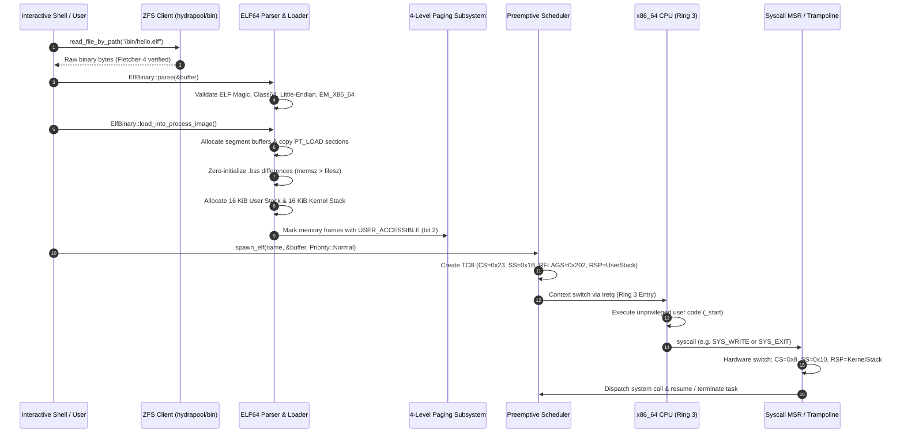

# Userspace ELF64 Binary Loader & Execution

## Overview

Hydra OS features an autonomous **Userspace ELF64 Binary Loader** capable of parsing, relocating, mapping, and executing standalone compiled x86_64 binaries directly from the OpenZFS storage medium (`hydrapool/bin`) in unprivileged **Ring 3 (CPL = 3)**.

Unlike monolithic firmware environments where user programs must be compiled directly into the kernel executable (e.g. via `include_bytes!`), Hydra decouples userland binaries from kernel firmware. Standalone `.elf` executables reside on the boot medium, are synchronized into OpenZFS with Fletcher-4 checksum verification, and are dynamically spawned into isolated unprivileged tasks.

The implementation is located across:
- **ELF64 Format Parser & Loader**: [`src/task/elf.rs`](file:///d:/os/src/task/elf.rs)
- **Task Control Block & Stack Allocation**: [`src/task/tcb.rs`](file:///d:/os/src/task/tcb.rs)
- **Scheduler Process Spawner**: [`src/task/scheduler.rs`](file:///d:/os/src/task/scheduler.rs)
- **Hardware Syscall Trampoline & Dispatcher**: [`src/arch/syscall.rs`](file:///d:/os/src/arch/syscall.rs)
- **Interactive Shell Command**: [`src/shell/commands/elf_cmd.rs`](file:///d:/os/src/shell/commands/elf_cmd.rs)
- **Direct Shell Invoker**: [`src/shell/fs.rs`](file:///d:/os/src/shell/fs.rs)

---

## Architectural Flow & Lifecycle



---

## ELF64 File Format Specification

The loader inspects and parses the standard 64-bit Executable and Linkable Format (ELF64):

### 1. ELF Header (`Elf64Header`)
Fixed 64-byte structure at byte offset 0 of the binary image:

| Field | Size | Description | Expected Value |
|---|---|---|---|
| `e_ident` | 16 bytes | Magic number, architecture class, data encoding | `0x7f, 'E', 'L', 'F'`, `ELFCLASS64`, `ELFDATA2LSB` |
| `e_type` | 2 bytes | Object file type | `ET_EXEC` (2, Fixed Addr) or `ET_DYN` (3, PIE) |
| `e_machine` | 2 bytes | Target CPU architecture | `EM_X86_64` (`0x003E`, AMD x86-64) |
| `e_version` | 4 bytes | ELF format version | `EV_CURRENT` (1) |
| `e_entry` | 8 bytes | Virtual address of the program entry point | Runtime `_start` address |
| `e_phoff` | 8 bytes | Program header table offset in file | Typically `0x40` (64 bytes) |
| `e_phentsize` | 2 bytes | Size of each program header entry | `56` bytes |
| `e_phnum` | 2 bytes | Number of program header entries | Typically 4 to 8 |

### 2. Program Header Table (`Elf64ProgramHeader`)
Each entry occupies 56 bytes and defines a contiguous segment in the process memory layout:

```rust
#[repr(C)]
#[derive(Debug, Clone, Copy)]
pub struct Elf64ProgramHeader {
    pub p_type: u32,    // PT_LOAD (1), PT_DYNAMIC (2), etc.
    pub p_flags: u32,   // PF_X (1), PF_W (2), PF_R (4)
    pub p_offset: u64,  // Offset in binary file image
    pub p_vaddr: u64,   // Virtual load address
    pub p_paddr: u64,   // Physical address (ignored in long mode)
    pub p_filesz: u64,  // Bytes stored in the file image
    pub p_memsz: u64,   // Total bytes in virtual memory (memsz >= filesz)
    pub p_align: u64,   // Segment alignment boundary
}
```

---

## Position-Independent Executables (PIE) & Segment Relocation

Hydra compiles userland binaries targeting `x86_64-unknown-none` with position-independent executable flags (`ET_DYN`). Because standard UEFI firmware utilizes identity mapping across the physical address space, fixed-address binaries (`ET_EXEC` at `0x400000`) could collide with hardware-mapped MMIO or kernel structures.

For `ET_DYN` binaries:
1. The loader determines the virtual span required across all `PT_LOAD` segments (`max(p_vaddr + p_memsz) - min(p_vaddr)`).
2. A backing buffer (`ElfProcessImage::image_buffer`) is allocated from the kernel heap.
3. The load base `base_addr` is assigned to the pointer of this backing buffer.
4. Each segment's file contents (`p_filesz`) are copied to `base_addr + p_vaddr`.
5. Any remaining `.bss` bytes (`p_memsz - p_filesz`) are zeroed using `core::ptr::write_bytes()`.
6. The runtime entry point is computed as `base_addr + header.e_entry`.
7. Page table entries backing the segment buffer are updated with the `USER_ACCESSIBLE` bit (bit 2) so unprivileged Ring 3 instructions can read, write, and execute them without triggering `#PF (Page Fault)`.

---

## Ring 3 Privilege Separation & Stack Architecture

Hydra enforces hardware ring separation using the x86_64 Global Descriptor Table (GDT) and Model-Specific Registers (MSRs):

### Segment Selectors

| Selector | Value | Privilege Level | Description |
|---|---|---|---|
| Kernel Code (`CS`) | `0x08` | Ring 0 | Privileged microkernel instructions |
| Kernel Data (`SS`) | `0x10` | Ring 0 | Privileged kernel stack and heap |
| User Data (`SS`) | `0x18 | 3 = 0x1B` | Ring 3 | Unprivileged userland stack and heap |
| User Code (`CS`) | `0x20 | 3 = 0x23` | Ring 3 | Unprivileged userland instruction stream |
| TSS Selector (`TR`) | `0x28` | Ring 0 | 64-bit Task State Segment (RSP0 for interrupts) |

### Dual Stack Architecture per User Task

Every userland task owns two distinct stacks:
1. **User Stack (16 KiB)**: Initialized at `ElfProcessImage::initial_user_rsp` and loaded into `RSP` upon transition to Ring 3. User local variables, stack frames, and function call returns occur here.
2. **Kernel Stack (16 KiB)**: Stored in `Task::kernel_stack_top` and loaded into `CURRENT_KERNEL_RSP` and the TSS `RSP0` pointer whenever the user process transitions to Ring 0 via hardware interrupts or `syscall`. This ensures that even if user code corrupts its user stack, the microkernel operates safely on an isolated, verified kernel stack.

---

## Hardware System Call Interface (`syscall` / `sysretq`)

Ring 3 binaries communicate with the microkernel via the x86_64 `syscall` instruction. The CPU performs an atomic transition without the overhead of legacy software interrupt gates (`int 0x80`).

### Model-Specific Register Configuration

During kernel initialization ([`src/arch/syscall.rs`](file:///d:/os/src/arch/syscall.rs)), the following MSRs are configured:

1. **`IA32_EFER` (`0xC0000080`)**: Bit 0 (`SCE - System Call Extensions`) is asserted to enable the `syscall` and `sysretq` instructions.
2. **`IA32_STAR` (`0xC0000081`)**:
   - Bits `[47:32] = 0x0008` (Kernel CS selector; SS becomes `0x0010`).
   - Bits `[63:48] = 0x0013` (User CS base selector; `sysretq` loads `SS = 0x1B` and `CS = 0x23`).
3. **`IA32_LSTAR` (`0xC0000082`)**: Configured with the 64-bit linear entry point of [`asm_syscall_entry`](file:///d:/os/src/arch/syscall.rs#L416-L477).
4. **`IA32_FMASK` (`0xC0000084`)**: Configured to `0x00044700` to automatically mask interrupt flag (`IF`), trap flag (`TF`), direction flag (`DF`), and alignment check (`AC`) upon entry.

### System Call Dispatch Table

| Syscall | Number (`RAX`) | Arguments | Description |
|---|---|---|---|
| `SYS_YIELD` | `1` | None | Relinquishes current timeslice to next ready task |
| `SYS_SLEEP` | `2` | `RDI` = Milliseconds | Blocks calling task for specified duration |
| `SYS_WRITE` | `3` | `RDI` = FD, `RSI` = Buffer Ptr, `RDX` = Length | Writes data to console or pipe descriptor |
| `SYS_EXIT` | `4` | None | Terminates userland process permanently |
| `SYS_GETPID` | `5` | None | Returns active task ID |
| `SYS_UPTIME` | `6` | None | Returns elapsed PIT timer ticks |
| `SYS_OPEN` | `9` | `RDI` = Path Ptr, `RSI` = Length, `RDX` = Flags | Opens file from OpenZFS storage |
| `SYS_CLOSE` | `10` | `RDI` = FD | Closes open file descriptor |
| `SYS_READ` | `11` | `RDI` = FD, `RSI` = Buffer Ptr, `RDX` = Count | Reads bytes from file descriptor |
| `SYS_PIPE` | `12` | `RDI` = Pointer to `[u64; 2]` | Creates anonymous unidirectional pipe |
| `SYS_DUP2` | `13` | `RDI` = Old FD, `RSI` = New FD | Duplicates file descriptor |

---

## Interactive Shell Commands & Examples

### 1. Inspecting ELF Headers (`elf --info`)

```bash
hydra:/bin> elf --info /bin/hello.elf

============================================================
 [+] HYDRA MICROKERNEL: ELF64 BINARY INSPECTOR & LOADER     
============================================================
  File Path       : /bin/hello.elf
  File Size       : 2344 bytes (Verified via ZFS Fletcher-4)
  Object Type     : Shared Object / PIE (ET_DYN - Position-Independent)
  Architecture    : AMD x86-64 (EM_X86_64, 64-bit Little-Endian)
  Entry Point     : 0x00000000000012b4
  Program Headers : 8 entries (at file offset 0x40)

  Program Headers Table (Segments):
    IDX  TYPE       FILE_OFFSET        VIRT_ADDR          FILE_SZ    MEM_SZ     FLAGS
    --------------------------------------------------------------------------------
    0    PHDR       0x0000000000000040 0x0000000000000040 0x000001c0 0x000001c0 R--   
    1    PT_LOAD    0x0000000000000000 0x0000000000000000 0x000002b4 0x000002b4 R--   
    2    PT_LOAD    0x00000000000002b4 0x00000000000012b4 0x0000001a 0x0000001a R-X   
    3    PT_LOAD    0x00000000000002d0 0x00000000000022d0 0x000000a0 0x00000d30 RW-   
    4    DYNAMIC    0x00000000000002d0 0x00000000000022d0 0x000000a0 0x000000a0 RW-   
============================================================
```

### 2. Direct Execution from OpenZFS

Users can launch binaries directly by typing their name or path:

```bash
hydra:/bin> hello.elf
[*] Executing ELF64 binary 'hello.elf' from ZFS File Server (Dataset: hydrapool/bin, 2344 bytes)...
[+] Spawned Ring 3 ELF process #2 ('hello.elf').
    Privilege: Unprivileged Ring 3 (CS=0x23, SS=0x1B, RFLAGS=0x202)

[ELF64 Userland] Greetings from standalone ELF64 binary in Ring 3!
[*] ELF process #2 completed and exited cleanly.

hydra:/bin> counter.elf
[*] Executing ELF64 binary 'counter.elf' from ZFS File Server (Dataset: hydrapool/bin, 2544 bytes)...
[+] Spawned Ring 3 ELF process #3 ('counter.elf').
    Privilege: Unprivileged Ring 3 (CS=0x23, SS=0x1B, RFLAGS=0x202)
[ELF Counter] Starting Ring 3 counting process...
[ELF Counter] Ring 3 countdown step 1
[ELF Counter] Ring 3 countdown step 2
[ELF Counter] Ring 3 countdown step 3
[ELF Counter] Finished! Exiting unprivileged Ring 3.
[*] ELF process #3 completed and exited cleanly.
```

### 3. Background Execution (`--bg`)

```bash
hydra:/bin> elf /bin/counter.elf --bg
[+] Spawned Ring 3 ELF process #4 ('/bin/counter.elf').
    Privilege: Unprivileged Ring 3 (CS=0x23, SS=0x1B, RFLAGS=0x202)
    Running in background. Type 'ps' to inspect execution.
hydra:/bin> ps
[PID]   [NAME]                  [PRIORITY]      [STATE]         [TICKS]
0       idle                    Idle            Ready           1420
1       shell                   Normal          Running         389
4       /bin/counter.elf        Normal          Sleeping(1450)  12
```
