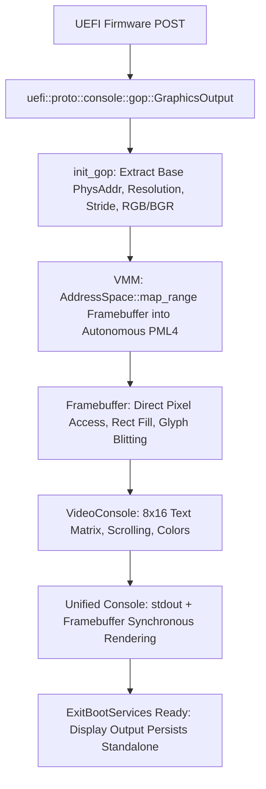

# Hardware Video Driver & GOP Framebuffer Documentation

- **Source Module**: [`src/video/`](file:///d:/os/src/video/)
- **Subsystem**: Display Driver, Linear Framebuffer & Autonomous Video Console

---

## 1. Conceptual Overview

Before an operating system can terminate firmware boot services (`ExitBootServices`), it must take complete ownership of the hardware display. Otherwise, text and graphics output will terminate with the firmware.

Hydra's video subsystem:
1. Discovers the **UEFI Graphics Output Protocol (GOP)** while boot services are active.
2. Retrieves the hardware's 32-bit linear physical framebuffer pointer, resolution (e.g. 1024x768 or native display), stride, and pixel format (`Rgb8` or `Bgr8`).
3. Uses Hydra's Virtual Memory Manager ([`AddressSpace::map_range`](file:///d:/os/src/memory/paging.rs#L311)) to map the entire physical framebuffer into Hydra's autonomous PML4 page table.
4. Integrates a lightweight **8x16 bitmap font engine** covering all printable ASCII characters.
5. Runs an **autonomous text-mode terminal emulator** directly on the pixel buffer, enabling `print!`, `println!`, colors, line wrapping, and hardware-accelerated vertical scrolling independent of UEFI firmware.

---

## 2. Video Architecture & Data Flow

---

## 3. Module Breakdown

| Source File | Role & Implementation |
| :--- | :--- |
| [`src/video/gop.rs`](file:///d:/os/src/video/gop.rs) | Hardware discovery via UEFI GOP, physical framebuffer extraction, and VMM page mapping. |
| [`src/video/font.rs`](file:///d:/os/src/video/font.rs) | 8x16 ASCII bitmap font table covering characters 32 to 126. |
| [`src/video/framebuffer.rs`](file:///d:/os/src/video/framebuffer.rs) | Direct linear pixel buffer controller: `put_pixel`, `fill_rect`, `clear`, `draw_char`, and `scroll_up` (`core::ptr::copy`). |
| [`src/video/console.rs`](file:///d:/os/src/video/console.rs) | Autonomous text terminal running on the pixel buffer. Implements `core::fmt::Write`, cursor management, line wrapping, and color mapping. |
| [`src/video/splash.rs`](file:///d:/os/src/video/splash.rs) | The Hydra boot logo and its spinner, shown instead of the boot messages. |
| [`src/video/mod.rs`](file:///d:/os/src/video/mod.rs) | Video subsystem coordinator and public API exports. |

---

## 4. Scope: an Emergency Console Only

The video subsystem is the kernel's emergency console: early boot messages, the boot logo (`splash.rs`), the Hydra shell and its login when no desktop runs, and kernel panic messages. It draws no windows. The desktop is KDE Plasma, whose compositor (KWin) draws through the Linux DRM device; that device borrows the framebuffer from the console (`console::release_display`) and gives it back on Ctrl+Alt+F1, when the session ends, and on a kernel panic (`console::panic_reclaim`, after which the DRM device stops drawing). `panic 30` in the shell panics 30 seconds later from a kernel task, to check that a panic shows over the desktop.

The framebuffer geometry is printed at boot (Step 3b).

---

## 5. Hardware Console Cursor Engine

The autonomous video console features a zero-allocation, lossless text insertion cursor:
- **Zero-Allocation Lossless XOR Inversion**: Implemented in [`Framebuffer::invert_rect`](file:///d:/os/src/video/framebuffer.rs#L104-L125). Inverts the RGB bytes (`!*ptr`) of target pixels without touching the alpha channel. This provides reversible display and erasure without allocating secondary scratch buffers.
- **Dynamic Cursor Shapes**: Supports three configurable cursor styles ([`CursorShape`](file:///d:/os/src/video/console.rs#L11-L19)):
  - `Underline`: 3-pixel horizontal bar at the baseline of the font cell (scanlines 13..16).
  - `Block`: Full 8x16 inverted character cell, maintaining readability through color inversion.
  - `Bar`: 2-pixel vertical line at the left boundary of the character cell.
- **Hardware-Synchronized Blinking**: In the console polling loops ([`get_key_or_refresh`](file:///d:/os/src/console.rs#L407-L426)), a 10ms timer step drives a ~1 Hz (500ms toggle interval) blinking rate while the shell waits for keyboard input.
- **Artifact Prevention**: Any operation that modifies the framebuffer (`write_char`, `new_line`, `clear`, `scroll_up`, or direct buffer writes) automatically invokes `hide_cursor()` prior to rasterization, preventing cursor ghosting artifacts.

---

## 6. The Screen Lent to the Display Service (wave 8)

Since wave 8 the Linux DRM device (`/dev/dri/card0`) is served by a ring-3 service, **display-server** (`userland/drivers/display-server`, service `display`, endpoint 0x23); the kernel's `compat/linux/drm.rs` stays as the switch back (`lx=kernel`, `lx.display=kernel`). The kernel keeps what the console needs to work with no user space ([`src/ipc/screen.rs`](../../src/ipc/screen.rs), `docs/display-input-design.md` sections 3.2 and 5):

- **Lending:** the service maps the screen once (`SYS_SCREEN` 73, `SCREEN_MAP`): the framebuffer's pages, then a status page. While the console owns the screen those pages lead to one scratch page. On the session's first picture (`SCREEN_TAKE`) the console moves to its off-screen copy (`release_display`, which also ends the boot logo) and the mapping is pointed at the framebuffer.
- **Taking it back is a remapping:** Ctrl+Alt+F1, the session's end (`SCREEN_GIVE`) and a crash of the service change the state word, then zap the service's mapping (`Mm::discard`, with the TLB shootdown) before the console repaints: nothing the service writes afterwards reaches the screen, and the kernel never waits for it. A kernel panic sets the state word without taking a lock and gives a copy in flight a moment to end (the service raises a "copying" word before it reads the state).
- **The hot keys** stay in `arch/keyboard.rs`; `drm::request_vt_switch` hands them to `ipc::screen` while the service's session holds the screen, and the `screend` task carries the switch out. Input is routed to the session only while it shows.
- **The service** completes page flips at an emulated 60 Hz vertical blank and holds the completions back while the console shows, so the desktop stops drawing behind Ctrl+Alt+F1.
- **A crash of display-server:** the console shows at once; its descriptors fail with `ENODEV` (the desktop session ends); the supervisor restarts it and the login screen comes back (`FailObjects`, decision 28).

## 7. Write-Combining and Writing Only What Changed (wave 11, Group G)

The user's NUC (wave 11) showed what a real firmware framebuffer costs: the firmware's memory type range registers make it **uncacheable**, so each 4-byte store is its own bus transaction. A whole 1920x1080 picture took about 90 ms to copy (`[display] ... copy avg 94418 us`): six pictures a second, a lagging pointer, and a cursor that blinked (the picture was written over it, then the cursor again).

- **PAT** ([`src/arch/pat.rs`](../../src/arch/pat.rs)): entry 1 of the page attribute table (selected by PWT alone) is write-combining on every CPU (Linux's layout; nothing else in the kernel asks for write-through). Stores to WC memory are gathered into 64-byte bursts, and a PAT WC type wins over an MTRR UC range.
- **The display service's mapping:** the screen object's framebuffer pages are mapped with PWT (`MappedObject::write_combining` in `memory/vm.rs`; the status and scratch pages keep the normal type).
- **The console:** at takeover it moves to a WC view of the framebuffer in the direct map (`pat::alias_wc`: the 2 MiB (or 1 GiB) entries that cover the framebuffer are split into 4 KiB ones, only the framebuffer's own pages become WC); the firmware's identity mapping stays for the boot logo.
- **display-server** keeps a RAM copy of what the screen shows (`native::Shadow`). Every draw (`native::draw_rect`) composes each row in RAM (the picture, black where there is none, the cursor blended in, red and blue swapped for an RGB screen), compares it with the copy in 16-pixel blocks (one 64-byte burst) and writes only the changed blocks (runs, short gaps merged). So the cursor is never erased on the screen, a flip of an unchanged picture writes nothing, and a cursor move writes only its old and new 64x64 areas. The copy is invalidated whenever the console drew on the screen (taking the screen, coming back from Ctrl+Alt+F1). The `[display]` line shows the cursor update time and the pixels written of those composed.
- QEMU (KVM) gives emulated device memory write-back whatever the guest asks, so there only the fewer writes show (copy avg 1.2-2 ms instead of 2-4 ms in the VM); the WC gain is the real hardware's.
